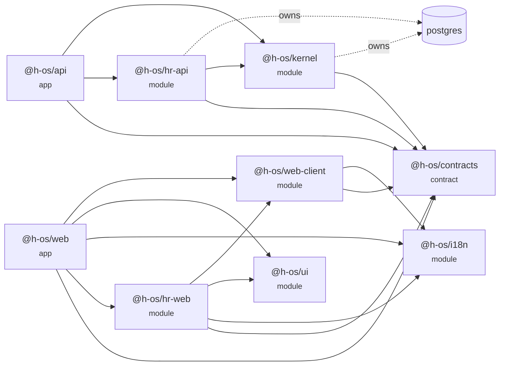
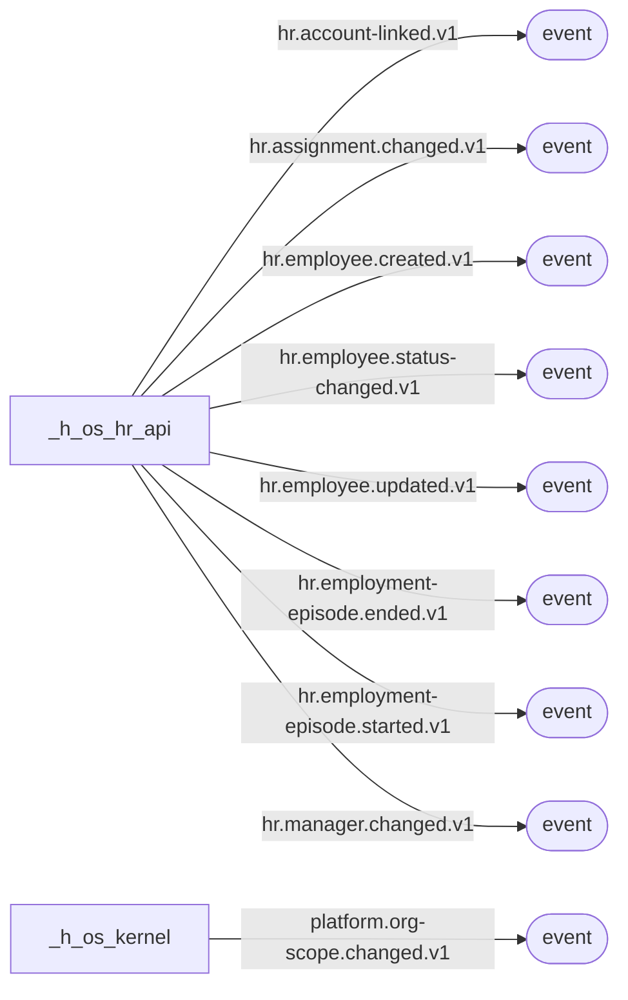

# Architecture graph

<!-- Generated by tools/graph/generate.mjs. Do not edit by hand (GRAPH-002). -->

19 nodes and 28 edges. Descriptions and ownership are hand-written in `overrides.json`; everything else is derived from the workspace, the sources and `pnpm-workspace.yaml`.

## Package dependencies

## Events

## Nodes

| id | type | owning app | path | data |
|---|---|---|---|---|
| `@h-os/api` | app | h-os | platform/api |  |
| `@h-os/contracts` | contract | h-os | platform/contracts |  |
| `@h-os/hr-api` | module | h-hr | apps/hr/api | 20 table(s) |
| `@h-os/hr-web` | module | h-hr | apps/hr/web |  |
| `@h-os/i18n` | module | h-os | platform/i18n |  |
| `@h-os/kernel` | module | h-os | platform/kernel | 10 table(s) |
| `@h-os/ui` | module | h-os | platform/ui |  |
| `@h-os/web` | app | h-os | platform/web |  |
| `@h-os/web-client` | module | h-os | platform/client |  |
| `datastore:postgres` | datastore | h-os |  | 30 table(s) |
| `hr.account-linked.v1` | event | h-hr | platform/contracts/src/events.ts |  |
| `hr.assignment.changed.v1` | event | h-hr | platform/contracts/src/events.ts |  |
| `hr.employee.created.v1` | event | h-hr | platform/contracts/src/events.ts |  |
| `hr.employee.status-changed.v1` | event | h-hr | platform/contracts/src/events.ts |  |
| `hr.employee.updated.v1` | event | h-hr | platform/contracts/src/events.ts |  |
| `hr.employment-episode.ended.v1` | event | h-hr | platform/contracts/src/events.ts |  |
| `hr.employment-episode.started.v1` | event | h-hr | platform/contracts/src/events.ts |  |
| `hr.manager.changed.v1` | event | h-hr | platform/contracts/src/events.ts |  |
| `platform.org-scope.changed.v1` | event | h-os | platform/contracts/src/events.ts |  |

## Event catalogue

| event | publisher |
|---|---|
| `hr.account-linked.v1` | `@h-os/hr-api` |
| `hr.assignment.changed.v1` | `@h-os/hr-api` |
| `hr.employee.created.v1` | `@h-os/hr-api` |
| `hr.employee.status-changed.v1` | `@h-os/hr-api` |
| `hr.employee.updated.v1` | `@h-os/hr-api` |
| `hr.employment-episode.ended.v1` | `@h-os/hr-api` |
| `hr.employment-episode.started.v1` | `@h-os/hr-api` |
| `hr.manager.changed.v1` | `@h-os/hr-api` |
| `platform.org-scope.changed.v1` | `@h-os/kernel` |
