# H-HR — Phase Zero Audit, Entity Proposal and Plan

- **Date:** 2026-10-29
- **Branch:** `main` (no commits yet; working tree entirely untracked)
- **Task:** Implement H-HR inside H-OS
- **Status of this document:** audit + proposal. **No application code was written.**
- **Author:** implementation agent (Caliper Execution)

---

## 1. Objective

Complete the mandatory pre-coding audit required by the task brief, establish what actually
exists in the repository, identify conflicts with the H-OS principles, propose the domain
decisions that must be approved before coding, and present an entity/relationship proposal and
an implementation plan.

---

## 2. Repository state (measured, not assumed)

### 2.1 Git

| Fact | Value |
|---|---|
| Repository root | `D:/DevOps/HiraTechLabs/H-OS` |
| Branch | `main` |
| Commits | **0** (`fatal: your current branch 'main' does not have any commits yet`) |
| Tracked files | **none** |
| Untracked | `H-HR/`, `H-OS/` (entire content) |
| Remote | `origin https://github.com/HiraTechLabs/H-OS.git` → `Repository not found` |
| Unrelated user changes to preserve | none tracked; the two principle trees are the only content |
| Stash | empty |

**Implication:** GIT-001/005 gates (protected `main`, PR checks, human approval) cannot be
exercised in this environment because the remote is unreachable from this machine. All work must
be committed locally on a short-lived branch and handed over for PR review.

### 2.2 Files present — complete inventory

There are exactly **26 files** in the repository. They are all Markdown.

**H-OS parent principles — `H-OS/.caliper/principles/`**

| File | Rules found |
|---|---|
| `CORE.md` | CORE-001 … CORE-013 (digest) |
| `README.md` | process/inheritance/resolver contract |
| `README.ar.md` | Arabic human overview |
| `tech-stack.md` | STK-001 … STK-011 + committed stack table + repository layout |
| `clean-architecture.md` | ARCH-001 … ARCH-015 |
| `clean-code.md` | CODE-001 … CODE-012 |
| `business.md` | BIZ-001 … BIZ-015 |
| `security.md` | SEC-001 … SEC-015 |
| `test.md` | TEST-001 … TEST-014 |
| `logs.md` | LOG-001 … LOG-010 |
| `performance.md` | PERF-001 … PERF-011 |
| `ui-ux.md` | UX-001 … UX-016 |
| `git.md` | GIT-001 … GIT-010 |
| `decisions.md` | DEC-001 … DEC-008 |
| `graph.md` | GRAPH-001 … GRAPH-007 |

**H-OS decisions — `H-OS/.caliper/decisions/`**

| File | Status |
|---|---|
| `DEC-0001-backend-stack.md` | **accepted** — NestJS + TypeScript on Node.js LTS |

**H-HR principles — `H-HR/.caliper/`**

| File | Principle IDs |
|---|---|
| `README.md` | purpose, inheritance rules, scope, ownership, restrictions |
| `00-domain.md` | HHR-DOM-001 … HHR-DOM-014 |
| `01-employee-records.md` | HHR-EMP-001 … 006, HHR-ORG-001 … 007 |
| `02-leave.md` | HHR-LEV-001 … HHR-LEV-014 |
| `03-attendance.md` | HHR-ATT-001 … HHR-ATT-011 |
| `04-compensation-payroll.md` | HHR-PAY-001 … HHR-PAY-014 |
| `05-access-integrations.md` | HHR-INT-001 … HHR-INT-010 |
| `06-security-privacy.md` | HHR-SEC-001 … HHR-SEC-009 |
| `07-ui-ux.md` | HHR-UX-001 … HHR-UX-013 |
| `08-testing-performance.md` | HHR-TEST-001 … 006, HHR-PERF-001 … 004 |
| `09-workflows.md` | HHR-WF-001 … HHR-WF-008 |

### 2.3 What does **not** exist

Verified by exhaustive recursive file listing:

- No `AGENTS.md`, no `CLAUDE.md`, no repository instructions of any kind.
- No `package.json`, `pnpm-workspace.yaml`, `turbo.json`, `tsconfig*.json`, ESLint/Prettier config.
- No application source — no `platform/`, no `apps/`, no `infra/`, no `docs/` (before this file).
- No database schema, no migrations, no Drizzle config.
- No `.caliper/graph/graph.json`, no graph generator.
- No CI workflow, no Dockerfile, no `docker-compose.yml`.
- No tests, no test runner config, no fixtures.
- No work-log convention (the brief's "existing logging conventions" refers to `logs.md`,
  which governs **runtime** structured logging, not development work logs).
- No identity provider, no auth layer, no shell, no design system, no `@h-os/ui`.
- No H-Archive, H-Asset, or H-Finance service or contract.

**This is a greenfield repository that contains architecture rules and one decision, and nothing
executable.** Every platform capability the H-HR principles tell H-HR to reuse does not exist yet.

### 2.4 Toolchain actually available on this machine

| Tool | Result |
|---|---|
| Node.js | `v22.20.0` (present; LTS line) |
| npm | `10.9.3` |
| pnpm | **not on PATH**; `corepack pnpm` fails with `Cannot find module ...\pnpm\12.16.1\bin\pnpm.cjs`. Fixable via `corepack prepare pnpm@<ver> --activate` or `npm i -g pnpm`. Network to `registry.npmjs.org` returns HTTP 200. |
| Docker CLI / Compose | `29.7.2` / `v5.5.1` present, **daemon not running** (`npipe:////./pipe/dockerDesktopLinuxEngine` not found) |
| PostgreSQL client | **absent** — the `psql` on PATH is an unrelated npm package (`yaml-config` error), not PostgreSQL |
| git | `2.49.0.windows.1` |
| corepack | `0.34.0` |

**Implication:** nothing can be built, migrated, or integration-tested until the workspace is
bootstrapped and Docker Desktop is started. Unit tests and type-checks can run without Docker.

---

## 3. Committed stack (binding, from `tech-stack.md` + `DEC-0001`)

| Area | Committed choice |
|---|---|
| Architecture | Modular monolith, one deployable, one PostgreSQL, **one schema per app** |
| Backend | TypeScript strict, Node.js LTS, **NestJS** |
| ORM / migrations | **Drizzle ORM**, SQL migrations via drizzle-kit |
| Database | PostgreSQL + `ltree`, `btree_gist`, `pgcrypto` |
| API | REST, OpenAPI 3.1 generated from code, generated typed client, `/api/v1`, RFC 9457 problem+json |
| Frontend | React, TS strict, Vite, TanStack Router + Query, Zustand (UI state only), react-hook-form + zod |
| UI | Tailwind + shadcn/ui (Radix) in one shared package `@h-os/ui`, i18next (en, ar), RTL from day one |
| Tables | TanStack Table |
| Auth | `AuthProvider` interface; **local provider first (argon2id)**; OIDC/Keycloak later |
| Events | **Transactional outbox** in PostgreSQL, in-process bus first |
| Jobs / cache | Redis + BullMQ — **only when a feature needs them, by Decision** |
| Files | `FileStorage` interface; local disk dev, S3 prod |
| Observability | pino, OpenTelemetry, Prometheus, Grafana, Loki |
| Quality | ESLint, Prettier, dependency-cruiser, knip, Vitest, Testcontainers, Playwright, axe |
| Monorepo | pnpm workspaces + Turborepo |
| Delivery | Docker, Compose, GitHub Actions |

---

## 4. Conflicts and blockers found

Each item cites the rule that creates the problem. None was resolved silently (CORE-001, DEC-007).

### B1 — Repository layout is ambiguous and contradicts `tech-stack.md` (blocking)

`tech-stack.md` §"Repository layout" defines the monorepo root as `H-OS/` containing
`platform/`, `apps/hr/`, `infra/`, `docs/`, and states H-HR deltas live at
`apps/hr/.caliper/principles/`.

The working tree instead has:

```
H-OS/                      <- git root
├── H-OS/                  <- parent principles + decisions only
│   └── .caliper/
└── H-HR/                  <- app principles only
    └── .caliper/
```

So the parent `.caliper/` is **not** at the repository root (where `graph.md` and `decisions.md`
expect it), and the H-HR deltas are **not** at `apps/hr/.caliper/`. This looks like an accidental
double-nesting from how the documents were extracted. Any workspace bootstrap I choose now
(flat root vs. nested vs. promote `H-OS/` to root) determines every future path, the graph
generator's output location, and the app-principles resolver path. **Cannot be chosen silently.**

→ Proposed: `DEC-0002-repository-layout-bootstrap.md`.

### B2 — The platform kernel, shell, design system and identity layer do not exist (blocking)

The brief and principles require H-HR to reuse the existing shell, design system, notifications,
identity and authorization. All of them are absent. `ARCH-013` restricts the kernel to
*identity, org-scope, events, audit, links, notifications* — a list that does **not** include the
workflow engine, while `BIZ-007` requires approvals to run on "the platform workflow engine" and
`HHR-WF-001/002/004` depend on it. There is therefore no sanctioned home for approvals.

→ Proposed: `DEC-0003-platform-kernel-scope.md` (relaxes `ARCH-013`, adds workflow + permissions).

### B3 — No approved design direction or tokens (blocking for any UI work)

`UX-005` forbids hardcoded colors and requires `@h-os/ui` tokens. `UX-014` presents the Deep Navy
`#172554` / Teal `#0D9488` palette explicitly as *"a proposal for evaluation and documentation
only, and does not constitute an approved architectural decision"*. `STK-011` requires a Decision
for any visualization library. Without approved tokens there is no lawful way to render a single
screen.

→ Proposed: `DEC-0004-design-tokens-and-shell.md`.

### B4 — Money representation and rounding are undecided (blocking for Phase Four)

`BIZ-002` permits *either* integer minor units *or* fixed-precision decimals, with a currency code;
`HHR-PAY-013` requires decimal-safe arithmetic with explicit precision and an approved rounding
policy. The **currency is not stated anywhere** in the repository, nor is the payroll frequency.
Choosing `numeric(18,4)` vs `bigint` minor units is a schema-wide, migration-visible decision.

→ Proposed: `DEC-0005-money-and-rounding.md`.

### B5 — Employment episode / rehire model is undecided (blocking for Phase One schema)

`HHR-WF-005` says rehire must not duplicate the employee or erase history and that
"employment-episode behavior" must be settled in an **approved domain decision**. The lifecycle
states in `HHR-DOM-003` are explicitly "candidate states" whose "final states and transitions must
be recorded in an approved domain decision". Both are prerequisites for the employee schema and
the status state machine.

→ Proposed: `HR-DEC-0001-employment-episodes-and-lifecycle.md`.

### B6 — Payroll jurisdiction and statutory scope are undecided (blocking for Phase Four)

No jurisdiction, currency, tax regime, social-insurance scheme, overtime premium, or payroll
calendar is recorded anywhere. `HHR-DOM-009`, `HHR-PAY-014`, `BIZ-012` and the brief itself forbid
inventing them. Statutory components therefore **cannot** be implemented now. What *can* be
implemented is an explainable, component-driven gross-to-net engine with no statutory logic.

Also unresolved: whether advances/loans are in scope (`HHR-PAY-003` says "where approved").

→ Proposed: `HR-DEC-0002-payroll-v1-scope.md`.

### B7 — `organization_id` on every table vs. single-company scope (needs a decision, low risk)

`BIZ-009`: *"Every business table carries `organization_id` and every query is scoped by it.
Deployment is single-tenant by default, but the model is tenant-aware from day one."*
The confirmed business scope says one company and forbids multi-tenant architecture unless
approved. These are compatible only if `organization_id` is a seeded single row with a
`DEFAULT`/guard — otherwise every query pays for a tenancy model nobody uses. Needs an explicit
statement that this is **tenant-aware single-tenant**, not multi-company.
→ Fold into the Phase One schema PR as `HR-DEC-0003-single-organization-scope.md`.

### B8 — Cost centers straddle two owners (needs a decision)

`01-employee-records.md` lists "cost centers" as H-HR organization data. `BIZ-015` makes
H-Finance the owner of financial structures. A cost center is both. If H-HR creates its own cost
center master, it becomes a competing source of truth the day H-Finance ships.
→ Fold into `HR-DEC-0004-cost-center-ownership.md`. Recommendation: H-HR stores an opaque
Finance cost-center reference plus a local read model, and does **not** author cost centers.

### B9 — Documents: `HHR-EMP-005` requires explicit approval for any temporary storage

H-Archive does not exist. Storing file bytes in H-HR would create the competing document store the
principle forbids. The only lawful v1 behaviour is to store **references** (opaque H-Archive
document IDs) plus HR classification/expiry metadata, and to render an explicit
"archive integration pending" state — never a fabricated successful upload.
→ Fold into `HR-DEC-0005-document-references-only.md`.

### B10 — Leave policies: shipping an engine with zero entitlements is unusable

`HHR-DOM-009` / `HHR-LEV-001` forbid encoding legal entitlements. But if v1 seeds no policy at all,
no leave request can ever be created, and no acceptance test can pass. The safe resolution is:
policy **configuration** is data (HR admin UI + seed script marked `non-production`), the engine
contains **no** default numbers, and acceptance tests create their own policies through the API.
→ Fold into `HR-DEC-0006-leave-policy-configuration.md`.

### B11 — Effective-dated overlap semantics for assignments

`BIZ-003` says overlaps are forbidden by database constraint and `STK-006` mandates `btree_gist`
exclusion constraints. But `HHR-ORG-004` requires **acting positions and temporary transfers to
coexist** with a primary assignment. A single blanket exclusion constraint on
`(employee_id, period)` would make lawful concurrent assignments impossible; no constraint at all
would allow double-booking. The constraint must be per assignment *kind*.
→ Fold into `HR-DEC-0007-effective-dated-assignment-overlap.md`.

### B12 — Graph cannot satisfy `GRAPH-002` yet

`GRAPH-002` requires structural facts to be **generated from code** and CI to fail when the
committed graph differs. There is no generator and no code to generate from. Hand-writing
`graph.json` would violate the rule the moment code lands.
→ Fold into the bootstrap PR as `DEC-0006-graph-generation.md`.

### B13 — H-HR principle files are not machine-parsable

`README.md` (parent) defines the heading grammar `### <ID> [<level>|<enforce>] <tags>` and states
the resolver ignores anything else. Every H-HR file uses `## HHR-DOM-001 — Title` instead, so the
Caliper resolver would select **none** of them. They are correct as human documentation but
invisible to the tooling the same repository specifies.
→ Fold into `DEC-0007-app-principles-format.md`. (Not a blocker for me: I read the files directly,
as the H-HR README instructs.)

### B14 — Verification gaps in this environment

- Docker daemon down → Testcontainers integration tests (`TEST-001`) and the Compose stack cannot run.
- pnpm not installed / corepack shim broken → workspace cannot be installed yet.
- No PostgreSQL client or server → migrations cannot be applied yet.
- Remote unreachable → no PR, no CI run, no merge.
These are environmental, not architectural, and are resolvable before the first PR is verified.
Until then **no test result may be reported as passing.**

---

## 5. Existing modules, contracts and services H-HR must reuse

**Nothing executable exists.** The reusable surface today consists of rules and one decision:

| Expected dependency | Actual state | Consequence for H-HR |
|---|---|---|
| `platform/api` kernel (identity, audit, outbox, links, notifications) | absent | must be built first, or H-HR cannot be authored |
| `platform/web` shell | absent | H-HR has no host |
| `@h-os/ui` design system | absent | no lawful components |
| AuthProvider / local argon2id provider | absent | no login, no authorization subject |
| Workflow/approvals engine (`BIZ-007`) | absent and unassigned | leave/attendance/payroll approvals unimplementable |
| H-Archive contract | absent | documents = references only |
| H-Asset contract | absent | custody panel = "integration pending" |
| H-Finance posting contract | absent | payroll → finance = outbox event only |
| Graph + generator | absent | `CORE-011` cannot be satisfied |
| Test/lint/build tooling | absent | **no repository commands exist to run** |

The brief says "use the existing repository's test, lint, type-check, and build commands… Do not
invent command names." Since none exist, the bootstrap PR will define them once, and every later
report will cite those real scripts.

---

## 6. Entity and relationship proposal (for approval before schema)

Grounded in the committed stack: PostgreSQL, one schema per app (`hr`), Drizzle, `ltree` for the
org tree, `btree_gist` exclusion constraints for effective dating, `pgcrypto` for column
encryption, decimal money, outbox for events.

### 6.1 Aggregate boundaries and transaction needs (`ARCH-008`)

| Aggregate | Consistency boundary | Why |
|---|---|---|
| **Employee** (`employee`, person, contact, emergency contacts) | one transaction | small, always read together by the profile |
| **Employment episode** (episode, contract, status transitions) | one transaction | rehire-safe; status machine is atomic |
| **Org assignment** (effective-dated snapshot + manager + schedule) | one transaction per change | close-and-replace is atomic; exclusion constraint enforces non-overlap |
| **Leave request** (request, per-day segments, transitions) | one transaction | approval is atomic and needs the balance lock |
| **Leave balance** (append-only ledger per employee × leave type) | ledger + lock row | balance is **derived**, never stored as a mutable number |
| **Attendance event stream** | append-only, immutable | `HHR-ATT-002`: never overwrite a punch |
| **Attendance day** | derived/recomputable | carries `calc_version` + input hash |
| **Payroll run** (run, input snapshot, payslips, lines) | finalization is one transaction | `HHR-PAY-006`: finalized rows are immutable |
| **Compensation** (effective-dated component values) | one transaction per change | salary history |

### 6.2 Organization & reference data

| Table | Key columns | Notes / constraints |
|---|---|---|
| `hr.branch` | `id`, `organization_id`, `code`, `name_en`, `name_ar`, `timezone`, `archived_at` | `unique(organization_id, code)`; timezone is data, never a constant (`BIZ-010`) |
| `hr.work_location` | `id`, `branch_id`, `code`, names, `address`, `timezone` | distinct from branch and from attendance origin (`HHR-ORG-006`) |
| `hr.org_unit` | `id`, `organization_id`, `parent_id`, `path ltree`, `kind` (`department`\|`team`), `code`, names, `manager_employee_id?` | `gist(path)`; `unique(organization_id, code)`; drives data scope (`BIZ-006`) |
| `hr.org_unit_history` | `id`, `org_unit_id`, `parent_id`, names, `effective_from`, `recorded_at`, `actor_id`, `reason` | append-only, supports "org as of date" (`HHR-ORG-005`) |
| `hr.job_title` | `id`, `code`, names, `archived_at` | separate from position and from security role (`HHR-ORG-001`) |
| `hr.job_grade` | `id`, `code`, `rank`, names | optional |
| `hr.work_schedule` + `hr.work_schedule_day` | `id`, `code`, `timezone`, `weekday`, `is_rest_day`, `start_local`, `end_local`, `break_minutes`, `crosses_midnight` | supports fixed/overnight/part-time; rotating patterns added in the Phase 3 sub-PR |
| `hr.holiday_calendar` + `hr.holiday_calendar_day` | `calendar_id`, `holiday_date`, names | weekend days & holidays are config, never constants (`BIZ-010`) |

### 6.3 Employee

| Table | Key columns | Notes |
|---|---|---|
| `hr.employee` | `id uuid PK` (**stable internal ID**, `HHR-DOM-001`), `organization_id`, `employee_number` (sequence, immutable, `unique`), `status`, `archived_at`, timestamps | never keyed by national ID/email/username |
| `hr.employee_person` | `employee_id PK/FK`, `given_name_en/ar`, `family_name_en/ar`, `date_of_birth`, `gender`, `nationality`, `marital_status`, `national_id_ciphertext`, `passport_ciphertext`, `national_id_hash` (for dup detection) | sensitive fields classified + encrypted (`SEC-008`) |
| `hr.employee_contact` | `employee_id`, `work_email`, `personal_email`, `phone`, `address_*` | |
| `hr.emergency_contact` | `id`, `employee_id`, `name`, `relationship`, `phone`, `priority`, `verified_at` | zero..n (`HHR-EMP-003`) |
| `hr.employment_episode` | `id`, `employee_id`, `episode_no`, `employment_type`, `start_date`, `end_date`, `probation_end_date`, `end_reason` | rehire = new episode, same employee (`HHR-WF-005`) |
| `hr.employment_contract` | `id`, `employment_episode_id`, `contract_type`, `start_date`, `end_date`, `signed_on`, `archive_document_id` (opaque), `terms_summary` | document **reference** only |
| `hr.employee_org_assignment` | `id`, `employee_id`, `org_unit_id`, `work_location_id`, `job_title_id`, `job_grade_id?`, `cost_center_ref?`, `work_arrangement`, `valid_from`, `valid_to`, `reason`, `approved_by`, `recorded_at` | `EXCLUDE (employee_id =, tstzrange(valid_from, valid_to) &&) WHERE (assignment_kind='primary')` |
| `hr.employee_manager_assignment` | `id`, `employee_id`, `manager_employee_id **NULL allowed**`, `kind` (`primary`\|`acting`), `valid_from`, `valid_to` | `NULL` is the explicit "no manager" representation (`HHR-ORG-002`) |
| `hr.employee_schedule_assignment` | `id`, `employee_id`, `work_schedule_id`\|`shift_pattern_id`, `valid_from`, `valid_to` | exclusion per employee |
| `hr.employee_status_transition` | `id`, `employee_id`, `from_status`, `to_status`, `effective_at`, `recorded_at`, `actor_id`, `reason`, `approval_ref` | append-only; machine from `HR-DEC-0001` |
| `hr.employee_account_link` | `employee_id`, `account_id` (opaque, platform-owned), `linked_at`, `unlinked_at` | **no cross-schema FK**; validated via contract (`ARCH-003`) |
| `hr.employee_document_ref` | `id`, `employee_id`, `archive_document_id`, `document_type`, `classification`, `issued_on`, `expires_on`, `status` | no bytes (`HHR-EMP-005`) |
| `hr.employee_change_request` | `id`, `employee_id`, `field_key`, `old_value`, `requested_value`, `reason`, `status`, `reviewer_id`, `decided_at`, `effective_on` | protected-field workflow (`HHR-EMP-004`) |
| `hr.employee_event` | `id`, `employee_id`, `event_type`, `effective_on`, `recorded_at`, `actor_id`, `reason`, `related_ref` | feeds the timeline (`HHR-EMP-006`) |

### 6.4 Compensation

| Table | Key columns | Notes |
|---|---|---|
| `hr.pay_component` | `id`, `code`, `kind` (`earning`\|`deduction`), `category` (`basic`\|`allowance`\|`bonus`\|`commission`\|`overtime`\|`advance`\|`statutory`\|`other`), `calculation_basis` (`fixed`\|`percent_of_basic`\|`per_unit`), `currency` | **catalog is configuration**, no legal defaults (`HHR-PAY-003`) |
| `hr.employee_pay_component` | `id`, `employee_id`, `pay_component_id`, `amount numeric(18,4)`\|`percent`, `currency`, `valid_from`, `valid_to`, `reason`, `approved_by` | exclusion per `(employee_id, pay_component_id)`; basic salary is `category='basic'` |
| `hr.employee_bank_account` | `id`, `employee_id`, `bank_name`, `iban_ciphertext`, `iban_last4`, `account_holder`, `valid_from`, `valid_to` | field-level encrypted; never logged (`HHR-SEC-006`) |
| `hr.employee_recurring_deduction` | `id`, `employee_id`, `pay_component_id`, `amount`, `cap_amount?`, `precedence`, `valid_from`, `valid_to`, `reason` | |
| `hr.employee_one_time_deduction` | `id`, `employee_id`, `pay_component_id`, `amount`, `applies_to_period_id`, `reason`, `status` | |

Advances/loans tables are **not** proposed for v1 — pending `HR-DEC-0002`.

### 6.5 Leave

| Table | Key columns | Notes |
|---|---|---|
| `hr.leave_type` | `id`, `code`, `category`, `name_en/ar`, `allowed_units` (`day`\|`half_day`\|`hour`), `requires_document`, `sensitive`, `archived_at` | categories include annual/sick/emergency/unpaid/compensatory/custom (`HHR-LEV-001`) |
| `hr.leave_policy_version` | `id`, `leave_type_id`, `version`, `effective_from`, `effective_to`, `accrual_method`, `accrual_rate numeric(10,4)`, `accrual_frequency`, `proration_rule`, `carryover_rule`, `carryover_expiry_months`, `max_balance`, `probation_eligible`, `min_service_months`, `max_continuous_days`, `negative_balance_policy`, `approval_chain_key`, `document_rules` | versioned + effective-dated (`HHR-LEV-002`); exclusion on `(leave_type_id, period)` |
| `hr.leave_balance_ledger` | `id`, `employee_id`, `leave_type_id`, `policy_version_id`, `entry_type` (`opening`\|`accrual`\|`usage`\|`reservation`\|`release`\|`cancellation`\|`expiry`\|`adjustment`\|`settlement`), `quantity numeric(10,4)`, `unit`, `effective_date`, `source_type`, `source_id`, `idempotency_key unique`, `actor_id`, `reason`, `created_at` | **append-only; balance = SUM** (`HHR-LEV-003`, `HHR-LEV-014`) |
| `hr.leave_balance_lock` | `employee_id`, `leave_type_id` (PK) | row locked `FOR UPDATE` during approval → no double-spend (`HHR-LEV-006`) |
| `hr.leave_request` | `id`, `employee_id`, `leave_type_id`, `policy_version_id`, `start_date`, `end_date`, `quantity`, `unit`, `reason_code`, `document_ref?`, `status`, `submitted_at`, `decided_at`, `version` (optimistic lock) | |
| `hr.leave_request_day` | `request_id`, `work_date`, `quantity`, `status` | enables **partial approval** (`HHR-LEV-005`) |
| `hr.leave_request_transition` | `id`, `request_id`, `from_status`, `to_status`, `actor_id`, `at`, `comment` | transition audit |

### 6.6 Attendance

| Table | Key columns | Notes |
|---|---|---|
| `hr.attendance_event` | `id`, `employee_id`, `event_type` (`entry`\|`exit`), `occurred_at timestamptz`, `timezone`, `source` (`web`\|`correction`), `received_at`, `idempotency_key unique`, `request_id` | **immutable**; entry+exit only, no biometric/geo (`HHR-ATT-003`) |
| `hr.attendance_correction_request` | `id`, `employee_id`, `target_event_id?`, `work_date`, `correction_type`, `proposed_value`, `reason`, `status`, `reviewer_id`, `decided_at` | separate from the event (`HHR-ATT-007`) |
| `hr.attendance_day` | `employee_id`, `work_date`, `schedule_version_ref`, `first_entry_at`, `last_exit_at`, `worked_minutes`, `late_minutes`, `early_exit_minutes`, `overtime_observed_minutes`, `overtime_approved_minutes`, `leave_request_id?`, `exception_codes text[]`, `calc_version`, `input_hash` | **derived & recomputable** (`HHR-ATT-011`) |
| `hr.overtime_request` | `id`, `employee_id`, `work_date`, `minutes`, `status`, `approver_id` | observed ≠ approved ≠ payable (`HHR-ATT-008`) |
| `hr.attendance_period` | `period_key`, `start_date`, `end_date`, `status` (`open`\|`closed`\|`reopened`), `closed_by`, `closed_at` | closed periods immutable (`HHR-ATT-009`) |

### 6.7 Payroll

| Table | Key columns | Notes |
|---|---|---|
| `hr.payroll_period` | `id`, `period_key`, `start_date`, `end_date`, `cut_off_at` | |
| `hr.payroll_run` | `id`, `payroll_period_id`, `run_no`, `status`, `calculation_version`, `rule_set_version`, `input_hash`, `result_hash`, `created_by`, `approved_by`, `finalized_at` | states per `HHR-PAY-006` |
| `hr.payroll_run_transition` | `run_id`, `from_status`, `to_status`, `actor_id`, `at`, `reason` | audit |
| `hr.payroll_input_snapshot` | `run_id`, `employee_id`, `attendance_summary`, `leave_summary`, `overtime_summary`, `compensation_refs`, `deduction_refs`, `cut_off_flags` | makes results reproducible (`HHR-PAY-005`) |
| `hr.payslip` | `id`, `payroll_run_id`, `employee_id`, `currency`, `gross_amount`, `total_deductions`, `net_amount`, `status` | employee-only access (`HHR-PAY-012`) |
| `hr.payslip_line` | `id`, `payslip_id`, `pay_component_id`, `kind`, `quantity`, `rate`, `amount`, `rule_version`, `explanation jsonb` | every line explains itself |
| `hr.payroll_adjustment` | `id`, `original_payslip_line_id`, `adjustment_payslip_line_id`, `type` (`correction`\|`reversal`), `reason`, `approved_by` | finalization is never edited (`HHR-PAY-009`) |

### 6.8 Platform kernel tables H-HR depends on (schema `platform`)

`organization` (single seeded row), `account`, `role`, `permission`, `role_permission`,
`account_role`, `session`, `audit_record`, `outbox_event`, `entity_link`, `notification`,
`workflow_definition`, `workflow_instance`, `workflow_task`, `approval_delegation`,
`integration_delivery`.

`OrgScopeResolver` is a **kernel interface implemented by H-HR infrastructure**, so the platform
never reads `hr` tables directly while `BIZ-006` still holds.

### 6.9 Entity relationship sketch

```mermaid
erDiagram
  BRANCH ||--o{ WORK_LOCATION : has
  ORG_UNIT ||--o{ ORG_UNIT : parent_of
  EMPLOYEE ||--|| EMPLOYEE_PERSON : has
  EMPLOYEE ||--o{ EMERGENCY_CONTACT : has
  EMPLOYEE ||--o{ EMPLOYMENT_EPISODE : "one per tenure"
  EMPLOYMENT_EPISODE ||--o{ EMPLOYMENT_CONTRACT : has
  EMPLOYEE ||--o{ EMPLOYEE_ORG_ASSIGNMENT : "effective dated"
  EMPLOYEE ||--o{ EMPLOYEE_MANAGER_ASSIGNMENT : "manager, nullable"
  EMPLOYEE ||--o{ EMPLOYEE_SCHEDULE_ASSIGNMENT : "effective dated"
  EMPLOYEE ||--o{ EMPLOYEE_PAY_COMPONENT : "effective dated"
  EMPLOYEE ||--o{ EMPLOYEE_DOCUMENT_REF : references
  EMPLOYEE ||--o{ EMPLOYEE_ACCOUNT_LINK : "nullable link"
  EMPLOYEE ||--o{ LEAVE_REQUEST : submits
  LEAVE_TYPE ||--o{ LEAVE_POLICY_VERSION : versioned
  LEAVE_REQUEST ||--o{ LEAVE_REQUEST_DAY : "partial approval"
  EMPLOYEE ||--o{ LEAVE_BALANCE_LEDGER : "derived balance"
  EMPLOYEE ||--o{ ATTENDANCE_EVENT : "immutable punches"
  ATTENDANCE_EVENT ||--o{ ATTENDANCE_CORRECTION_REQUEST : "corrected by"
  EMPLOYEE ||--o{ ATTENDANCE_DAY : "derived"
  PAYROLL_PERIOD ||--o{ PAYROLL_RUN : contains
  PAYROLL_RUN ||--o{ PAYSLIP : produces
  PAYSLIP ||--o{ PAYSLIP_LINE : "explained by"
```



---

## 7. Decisions requiring approval before coding

| ID | Title | Blocks |
|---|---|---|
| `DEC-0002` | Repository layout and monorepo bootstrap | everything |
| `DEC-0003` | Platform kernel scope, incl. workflow engine (relaxes `ARCH-013`) | phases 1–5 |
| `DEC-0004` | Design tokens, shell and accessibility baseline | all UI |
| `DEC-0005` | Money representation, currency and rounding | phase 4 |
| `HR-DEC-0001` | Employment episodes and lifecycle state machine | phase 1 schema |
| `HR-DEC-0002` | Payroll v1 scope and jurisdiction deferral | phase 4 |
| `HR-DEC-0003` | Tenant-aware single organization | phase 1 schema |
| `HR-DEC-0004` | Cost-center ownership | phase 1 schema |
| `HR-DEC-0005` | Document references only | phase 1 |
| `HR-DEC-0006` | Leave policy configuration, zero built-in entitlements | phase 2 |
| `HR-DEC-0007` | Effective-dated overlap semantics | phase 1 schema |

Written as `proposed` files now: `DEC-0002`, `DEC-0003`, `DEC-0004`, `DEC-0005`,
`HR-DEC-0001`, `HR-DEC-0002`.

The remaining seven (B7–B13) are stated in §4 with a recommendation and will be raised as
`proposed` decisions inside the PR that first needs them, because `DEC-001` requires a Decision
*before the merge that depends on it*, not before the audit:

- `HR-DEC-0003` tenant-aware single organization (B7)
- `HR-DEC-0004` cost-center ownership (B8)
- `HR-DEC-0005` document references only (B9)
- `HR-DEC-0006` leave policy configuration (B10)
- `HR-DEC-0007` effective-dated overlap semantics (B11)
- `DEC-0006` graph generation tooling (B12)
- `DEC-0007` app-principles machine-readable format (B13)

---

## 8. Implementation plan (sequenced, each step its own PR)

Branch naming per `GIT-002`; Conventional Commits with `hr` scope per `GIT-003`.

| # | Branch | Content | Depends on |
|---|---|---|---|
| 0 | `chore/platform-repo-bootstrap` | pnpm workspace + Turborepo, strict tsconfig, ESLint/Prettier, Vitest, dependency-cruiser, knip, Compose (Postgres 16 + extensions), `.env.example`, health endpoint, Graph generator, CI workflow, `AGENTS.md` recording real commands | DEC-0002, DEC-0006 |
| 1 | `feat/platform-kernel-identity` | `AuthProvider` + local argon2id, accounts, roles, permissions, deny-by-default global guard, org-scope contract, audit recorder, transactional outbox, entity links, notifications | DEC-0003 |
| 2 | `feat/platform-shell-design-system` | `@h-os/ui` tokens, shell chrome, launcher, i18n scaffolding (en/ar), RTL switch, entity-link hover cards | DEC-0004 |
| 3 | `feat/hr-org-foundation` | branch, location, `org_unit` + `ltree`, titles, grades, schedules, holiday calendars, admin UI | 0–2 |
| 4 | `feat/hr-employee-foundation` | employee, person, contact, emergency contacts, episodes, contracts, assignments, manager, account link, document refs, timeline, list/search/profile, audit, field-level permissions | 3, HR-DEC-0001/0003/0004/0005/0007 |
| 5 | `feat/hr-leave-engine` | leave types, policy versions, accrual, ledger, balance reconstruction, locks | 4, HR-DEC-0006 |
| 6 | `feat/hr-leave-requests` | request lifecycle, per-day partial approval, overlap detection, cancellation, delegation/escalation via workflow, calendar | 5, DEC-0003 |
| 7 | `feat/hr-attendance` | events, idempotency, duplicate/missing detection, schedules, exceptions, corrections, day calculation, period close/reopen, overtime requests | 4 |
| 8 | `feat/hr-compensation` | pay-component catalog, effective-dated values, bank accounts, recurring/one-time deductions | 4, DEC-0005 |
| 9 | `feat/hr-payroll` | periods, cut-off, run lifecycle, deterministic calculation, explanations, payslips, finalize/reverse, finance outbox + delivery tracking | 5–8, HR-DEC-0002 |
| 10 | `feat/hr-self-service` | employee self-service scope, correction requests, payslips, document references, dashboards | 9 |
| 11 | `test/hr-e2e-a11y-rtl` | Playwright journeys, axe, RTL/LTR, three viewports, permission matrix, cross-app navigation | 2–10 |

Each row will need further splitting to respect `GIT-004` (~400 changed lines); the table records
intent, not PR size.

### Non-goals for v1 (explicit)

GPS/geofencing/photos/biometric; multi-company; statutory tax or social insurance; a second
ledger; file bytes in H-HR; OIDC/Keycloak; Redis/BullMQ until a feature needs it; any charting
library before `STK-011` approval.

---

## 9. Tests executed in this phase

None. There is no test runner, no package manifest and no source. The only commands executed were
read-only environment probes, recorded verbatim in §2.4 and §2.1.

**No test, lint, type-check or build result is claimed as passing.**

---

## 10. Blockers

1. **B1** layout — needs `DEC-0002` approval.
2. **B2** absent kernel/shell/identity — needs `DEC-0003`, `DEC-0004`; also a scope decision on
   whether platform bootstrap is part of this assignment.
3. **B5/B6** employment episodes and payroll jurisdiction — need `HR-DEC-0001`, `HR-DEC-0002`.
4. **B4** money/currency — needs `DEC-0005`.
5. **Environmental:** Docker daemon not running; pnpm missing; no PostgreSQL server; remote
   repository unreachable (so PR/CI/merge cannot happen here).

## 11. Next step

Await approval of `DEC-0002`–`DEC-0005` and `HR-DEC-0001`/`HR-DEC-0002`, plus confirmation that
building the platform bootstrap (rows 0–2 of the plan) is in scope. On approval I start with
row 0, and the first report after that will contain real install/lint/type-check/test output.

---

## 12. Outcome (2026-10-29)

Approval was given for **bootstrap + Phase One only**. The delivery, its verified commands, live UI
smoke test, defects found during verification, limitations and the recommended next task are recorded
in [`2026-10-29-h-hr-phase-01-delivery.md`](./2026-10-29-h-hr-phase-01-delivery.md). Screens and states
are specified in [`apps/hr/docs/ui-spec.md`](../../apps/hr/docs/ui-spec.md).
